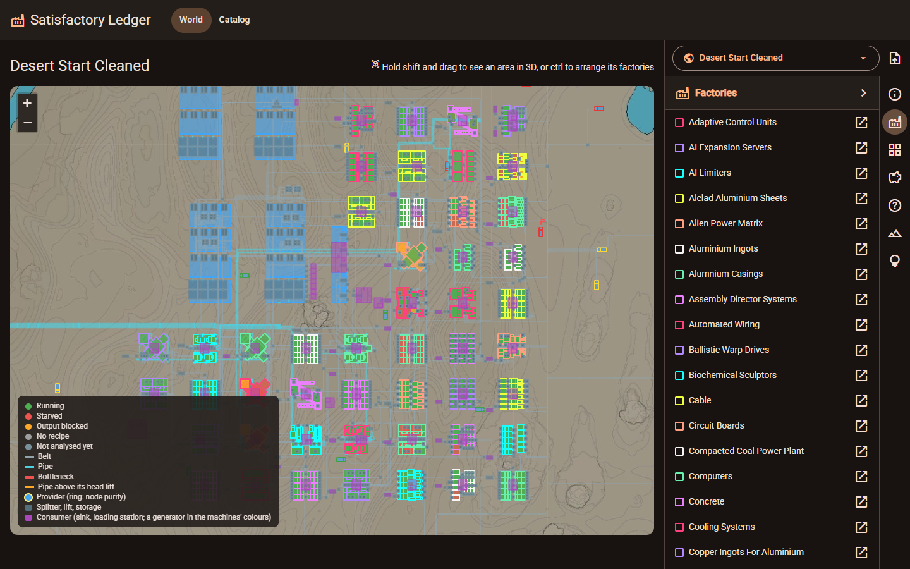
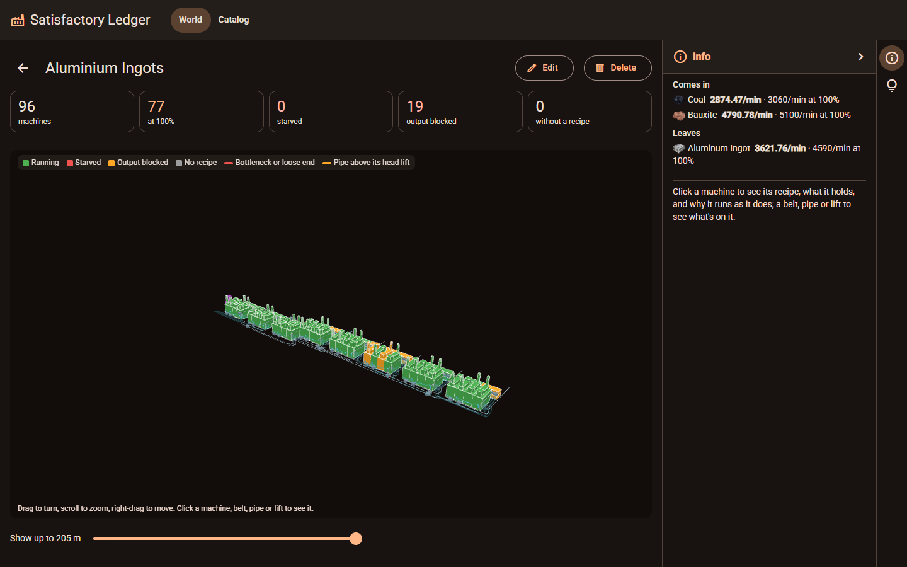
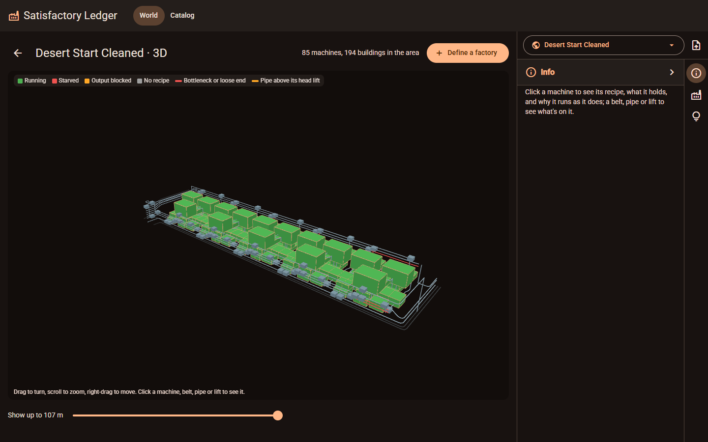
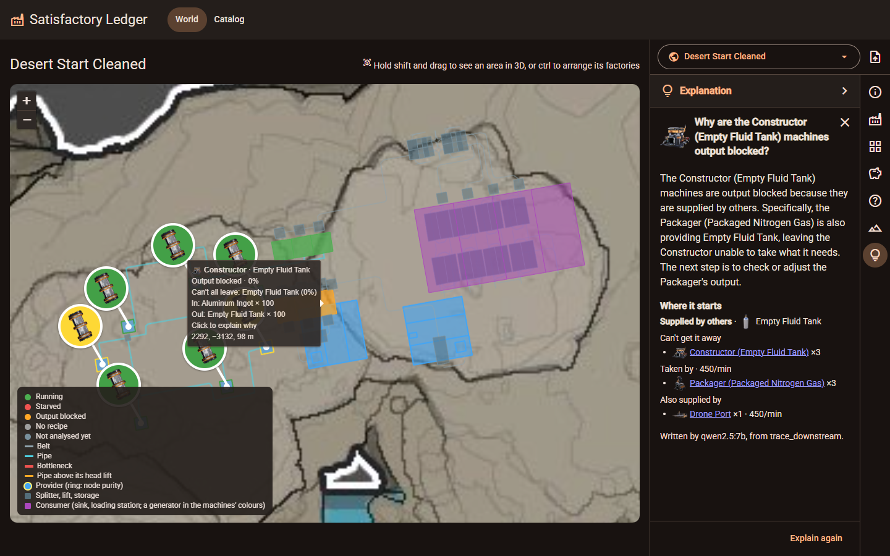
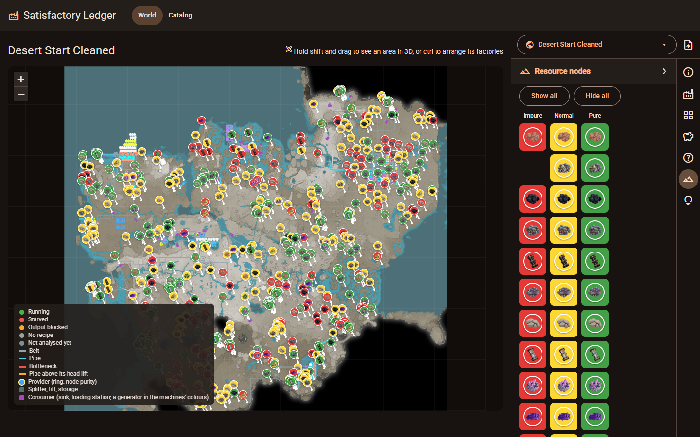
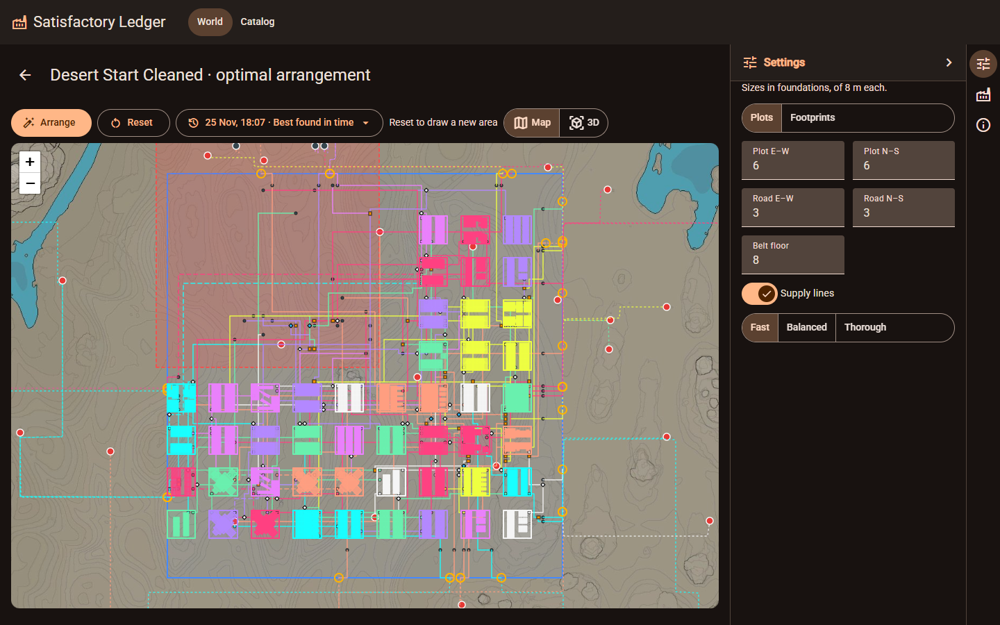
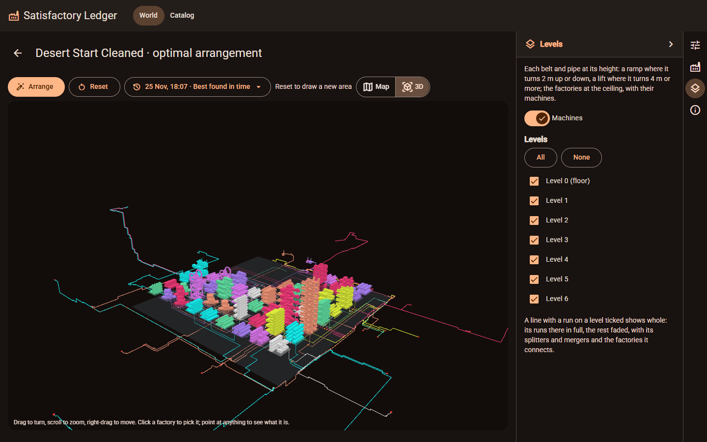
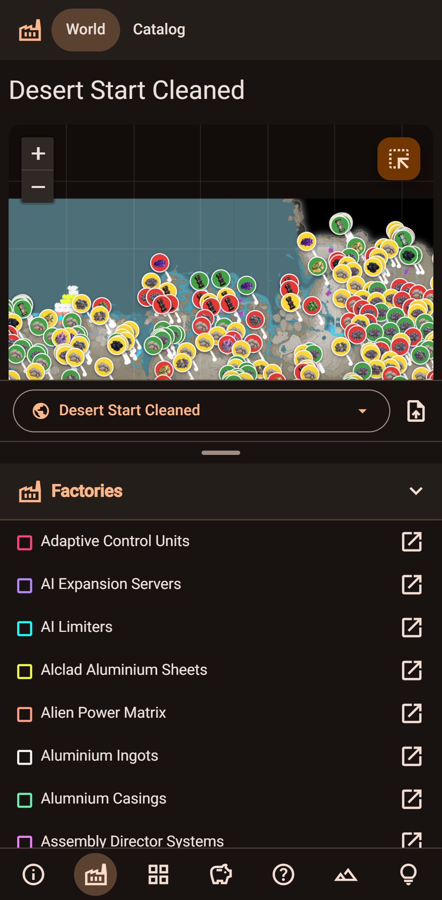
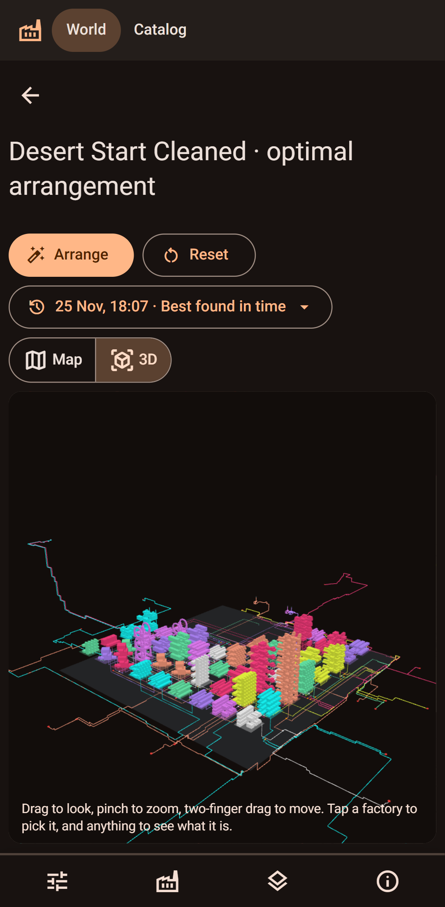

# Satisfactory Ledger

[](https://github.com/tmaartent/SatisfactoryLedger/actions/workflows/ci.yml)

An offline ledger of a Satisfactory world. It reads the world from the game's save file, simulates what flows through every belt and pipe, and finds the flaws: machines that are starved or output blocked, bottlenecks, supply nobody uses. It can also propose a better layout for your factories, with their belts routed. It replaces a hand-maintained spreadsheet that only knew what was typed into it.

It is also a deliberate learning and portfolio project. It shows Domain-Driven Design, Test-Driven Development, API design and a modern .NET + Angular stack, built as a modular monolith with a few services beside it. Follow the [learning guide](docs/guide/README.md) and the [step logs](docs/guide/log/).

And it is a research project in AI engineering:

- **Agentic development.** The code is written using leading agentic development practices, with agent swarms: each step test-first, with the owner deciding the domain and reviewing every change.
- **MCP.** An [MCP server](docs/adr/0029-mcp-server-over-the-public-api.md) gives a language model the world's facts as tools: what a factory takes in, where a shortage starts, what supplies it.
- **Local LLMs.** An [assistant](docs/adr/0030-assistant-explains-a-finding.md) explains a finding in words with a model running locally on Ollama, or with Claude, from the facts the MCP server returns, and flags any number in its answer that isn't in those facts.
- **What's next** is in [AI enhancements](docs/domain/ai-enhancements.md): evals from real cases, RAG over the docs and game data, plain language to a plan, and fine-tuning a local model.

## What it does

The screenshots are of a real world, *Desert Start*, in the model.

### The world on a map

Import a save, and every building is on the map: machines in the colour of how they run (running, starved, output blocked), each factory edged in its own colour, belts and pipes, stations and resource nodes. Point at a machine for its recipe, what it holds and why it runs as it does.



### Factories, and what holds them back

Define a factory by picking its machines in 3D. Its page says what comes in and what leaves, at 100% and now, how many machines run, are starved or output blocked, and where its bottlenecks are.



### Any area in 3D

Drag over the map to see an area in 3D: machines at their heights, belts, lifts and pipes as built, bottlenecks and pipes above their head lift marked.



### Why a machine is held back, in words

Click a starved or output-blocked machine to ask why. A local language model (or Claude, with an API key) explains it from the facts the tool traces: where the shortage starts, what supplies it, and what else takes from the same line. The facts are shown with it, so the words can be checked.



### Resource nodes

Pick which resource nodes the map shows, per resource and purity.



### An optimal arrangement

Draw an area, and the tool proposes where its factories would best stand, so the belts between them, and to their nodes and stations, are shortest. It routes those belts on a floor below the factories, as supply lines topped up by priority mergers, without crossings where it can. Factories take a plot each, or their own footprint.





### On a phone or tablet

Every page works on a touch screen: the sidebar becomes a sheet over the page, areas are selected with a button, and a tap says what something is.

<p>
  
  
</p>

## Getting the code

The save-file reader is a git submodule ([ADR-0013](docs/adr/0013-read-the-save-with-satisfactorysavenet.md)), so clone with:

```bash
git clone --recurse-submodules https://github.com/tmaartent/SatisfactoryLedger.git
# or, in an existing clone:
git submodule update --init
```

## Getting started

You need the .NET 10 SDK, Node.js and Docker. One command starts everything: PostgreSQL, RabbitMQ, Ollama, the API, the analysis service, the assistant and the web app.

```bash
dotnet run --project src/SatisfactoryLedger.AppHost   # the Aspire dashboard opens; the app is at http://localhost:4200
```

The first run downloads the local language model (about 4.7 GB); until then only explanations wait. To use Claude as well:

```bash
dotnet user-secrets set Parameters:anthropic-api-key <key> --project src/SatisfactoryLedger.AppHost
```

Then, in the app:

1. **Catalog:** import the game's Docs file (`CommunityResources/Docs/en-US.json` in the game folder).
2. **World:** import a save (`%LOCALAPPDATA%\FactoryGame\Saved\SaveGames`) with the button beside the snapshot picker. Each import is a snapshot.

## After a game update

1. Import the game's Docs file into the Catalog again.
2. Write the resource node table, and if you like the map picture and the icons, from the game install, then import them into the Catalog:

   ```bash
   dotnet run --project tools/SatisfactoryLedger.MapExtractor -- --game "<game folder>" --game-version 1.2 \
     --map-art map-art.json --icons icons.json
   # then POST each as "file": resource-nodes.json to /api/v1/catalog/resource-node-imports,
   # map-art.json to /api/v1/catalog/map-art-imports, icons.json to /api/v1/catalog/icon-imports
   ```

The map picture and the icons are Coffee Stain Studios' art: they come from your own game install and are never committed. The screenshots above show them.

## Tech stack

| Layer | Choice |
|---|---|
| Backend | .NET 10 (LTS), C# 14, ASP.NET Core minimal APIs, Wolverine |
| Persistence | EF Core + PostgreSQL |
| Messaging | RabbitMQ, with a transactional outbox, to the analysis service |
| Solvers | Google OR-Tools: linear programmes for the flow, CP-SAT for the arrangement |
| AI | An MCP server over the public API; an assistant on Ollama (qwen2.5) or Claude |
| Orchestration | .NET Aspire 13 (local dev, observability) |
| Frontend | Angular 22: standalone, signals, zoneless; Angular Material, Leaflet, three.js |
| Tests | xUnit v3 (Microsoft Testing Platform), architecture tests, Testcontainers, Vitest, Playwright |

## Repository layout

```
src/
  SatisfactoryLedger.AppHost/          Aspire orchestrator: run this to start everything
  SatisfactoryLedger.ServiceDefaults/  OpenTelemetry, health checks, resilience
  SatisfactoryLedger.Api/              The single ASP.NET Core host: composes the modules
  SatisfactoryLedger.AnalysisService/  Computes analyses and arrangements, over RabbitMQ
  SatisfactoryLedger.Mcp/              MCP server: the world's facts as tools for a language model
  SatisfactoryLedger.Assistant/        Explains a finding in words, from the MCP server's facts
  SatisfactoryLedger.SharedKernel/     Tiny set of concepts shared by all contexts (e.g. Rate)
  Modules/
    Catalog/            game data: items, recipes, buildings, belt/pipe tiers, nodes, icons
    World/              the world from the save file, factories, analysis (core domain)
      *.Domain          pure domain model, no framework references
      *.SaveFile        reads the save into the domain model
      *.Simulation      the flow and the arrangement solvers
      *                 application + infrastructure + endpoints (internal)
      *.Contracts       the only thing other modules may reference
tests/
  *.Domain.Tests        fast unit tests, written test-first
  ArchitectureTests     enforce the module and layer rules
  Api.IntegrationTests  HTTP-level tests against a real database
web/                    Angular frontend, with Vitest and Playwright tests
docs/                   architecture, domain, ADRs, learning guide
tools/
  SatisfactoryLedger.MapExtractor/    Writes the resource node table from a game install (ADR-0015)
```

## Documentation

- [Architecture overview](docs/architecture/overview.md)
- [Glossary](GLOSSARY.md) · [context map](docs/domain/context-map.md) · [business rules](docs/domain/business-rules.md)
- [Architecture Decision Records](docs/adr/README.md)
- [Learning guide: step by step, with best practices](docs/guide/README.md)
