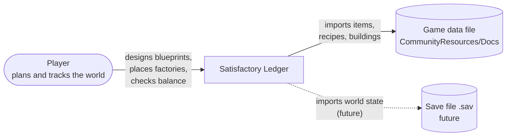
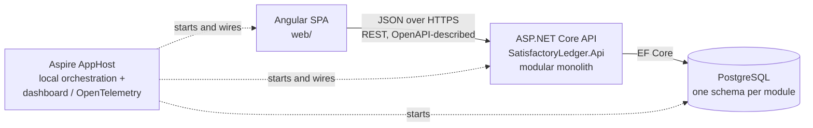
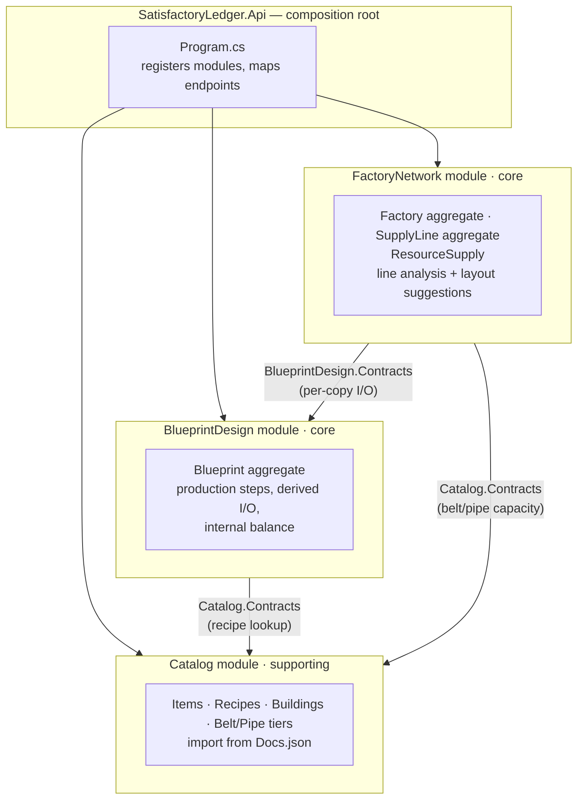
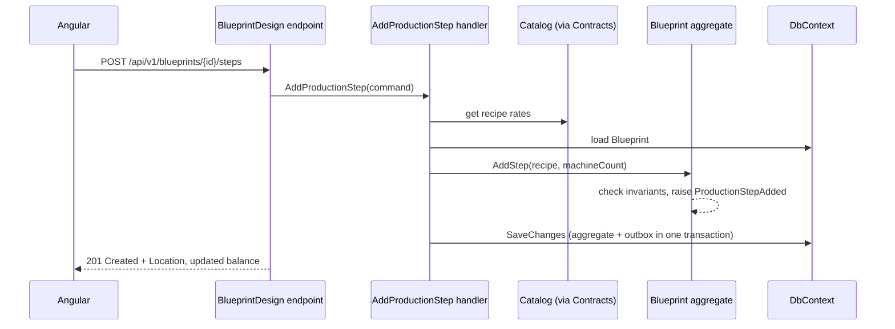

# Architecture overview

This document follows the [C4 model](https://c4model.com): context → containers → components → code. Decisions behind it are recorded in the [ADRs](../adr/README.md).

## 1. Goals and constraints

| Quality goal | What it means here |
|---|---|
| **Correctness** | Balancing must be exact: 7.5/min stays 7.5/min. The domain is the most important and most tested part. |
| **Evolvability** | Module boundaries are enforced, so a module can become a separate service without rewriting it. |
| **Showcase value** | The structure, tests, ADRs and API should read as senior-level work to someone browsing the repo. |
| **Offline first** | Runs entirely on one machine. No cloud dependencies required. |

Constraints: a single developer, a learning project, and a game-data source (`Docs.json`) that changes with game updates.

## 2. System context (C4 level 1)



## 3. Containers (C4 level 2)



- **One deployable backend.** The API host composes all modules in-process.
- **One database, a schema per module.** A module never reads another module's tables. This is the cheapest boundary to enforce now and the most expensive to fix later.
- The **TypeScript API client is generated** from the OpenAPI document (ADR-0006), so the frontend can't drift from the contract.

## 4. Components: the modules (C4 level 3)



Dependencies only point **downstream** (Network → Blueprint → Catalog) and only through `*.Contracts`. See the [context map](../domain/context-map.md) for the DDD relationships.

### Inside a module

Each module consists of three projects (ADR-0003):

```
SatisfactoryLedger.<Module>.Domain      entities, value objects, domain services, domain events
                                         → references only SharedKernel. No EF, no ASP.NET.
SatisfactoryLedger.<Module>             application layer (use cases / handlers)
                                         infrastructure (EF DbContext, configurations, importers)
                                         endpoints (minimal API route group)
                                         → all types internal, exposes one AddXxxModule() / MapXxxEndpoints()
SatisfactoryLedger.<Module>.Contracts   public DTOs, integration events, query interfaces
                                         → the only assembly other modules may reference
```

This is *vertical slices across modules, clean layering within a module*. The `Domain` project boundary is checked by the compiler. Everything else is checked by architecture tests.

### Dependency rules (enforced in `tests/SatisfactoryLedger.ArchitectureTests`)

1. `*.Domain` depends on nothing but `SharedKernel` and the BCL.
2. A module may depend on another module's `*.Contracts` only, never its `Domain` or implementation.
3. `*.Contracts` depends on nothing (primitive types and records only).
4. `Api` only calls each module's public registration and endpoint-mapping methods.
5. No cycles between modules.

## 5. Runtime view: two key flows

**Designing a blueprint (command):**



**Analysing a supply line (query):** load the `SupplyLine` with its taps and injections → ask Blueprint contracts for each tapped factory's per-copy demand × stack height → the `SupplyLineAnalyzer` domain service walks the belt segment by segment → return the segments with flow, remaining capacity, deficit, stranded and overflow amounts.

## 6. Cross-cutting concerns

| Concern | Approach |
|---|---|
| Errors | Domain failures are returned as results, not thrown, and mapped to RFC 9457 ProblemDetails with a stable `code`. Exceptions are reserved for bugs. |
| Validation | Request shape is checked at the endpoint (.NET 10 minimal API validation). Business rules are checked in the domain. Never duplicate a rule in both. |
| Concurrency | Optimistic: row version → `ETag` / `If-Match` (412 on conflict). |
| Observability | OpenTelemetry via ServiceDefaults; traces and logs in the Aspire dashboard. |
| Module communication | Synchronous: query interfaces in Contracts. Asynchronous: integration events through an outbox (introduced when first needed). |
| Time and IDs | Inject `TimeProvider`. Strongly typed IDs (`BlueprintId`, `FactoryId`) to prevent mix-ups. |

## 7. Evolution path

1. **Now:** modular monolith, in-process module calls.
2. **When a real reason appears:** introduce an in-process event bus and an outbox for integration events. A candidate trigger is FactoryNetwork reacting to a changed blueprint.
3. **Extraction showcase:** move **Catalog** into its own service. It's read-mostly and has a clean contract, so it's the lowest-risk candidate. Contracts become HTTP and messages, Aspire wires both services, and an ADR documents the before/after.

Microservices are a means, not a goal. See [guide step 8](../guide/08-towards-microservices.md).
