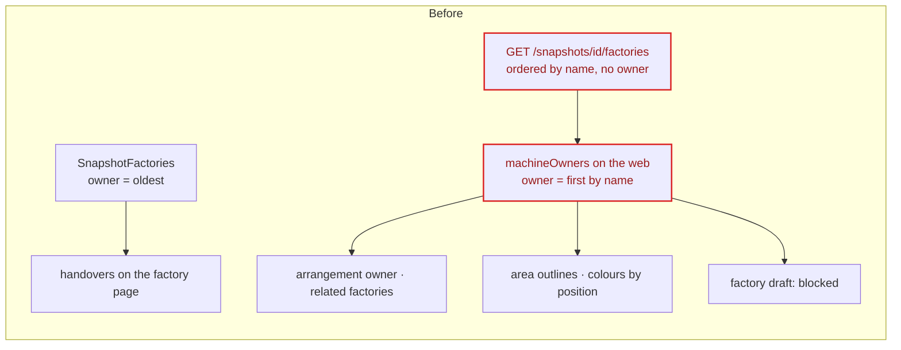
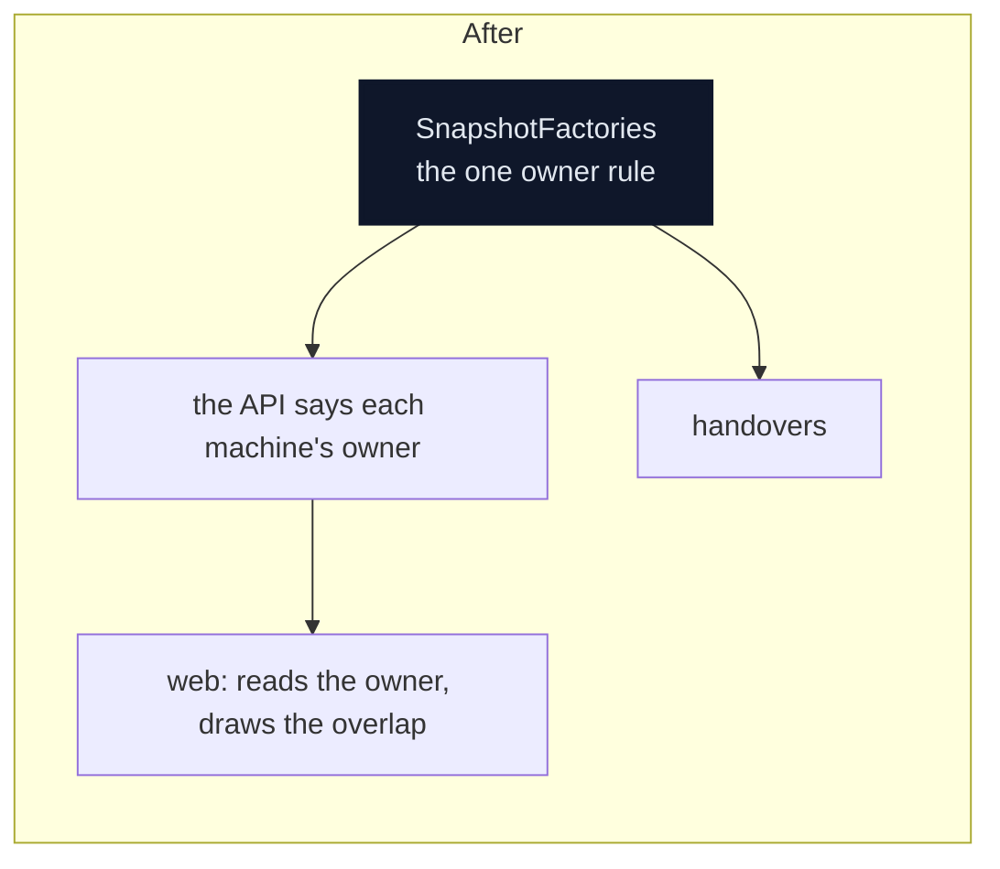
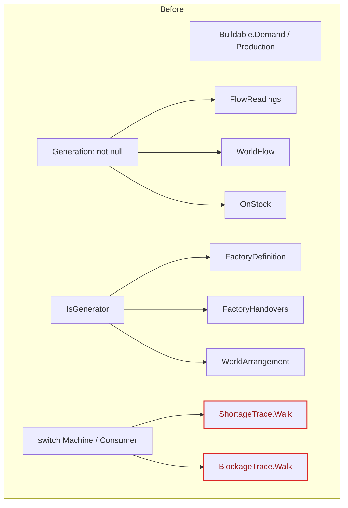
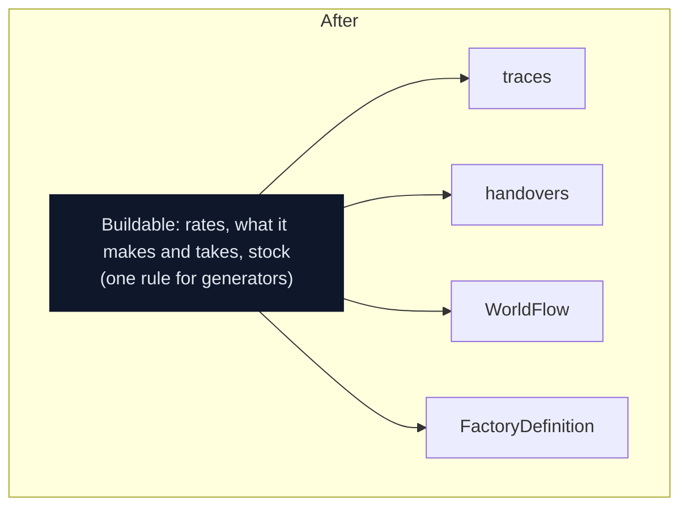
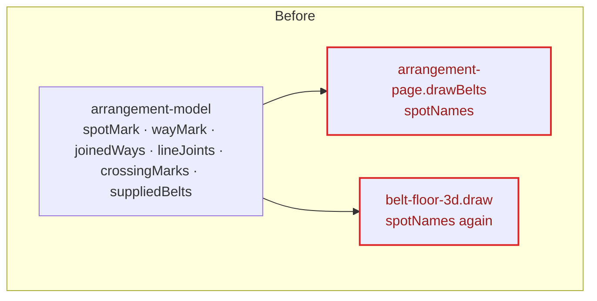
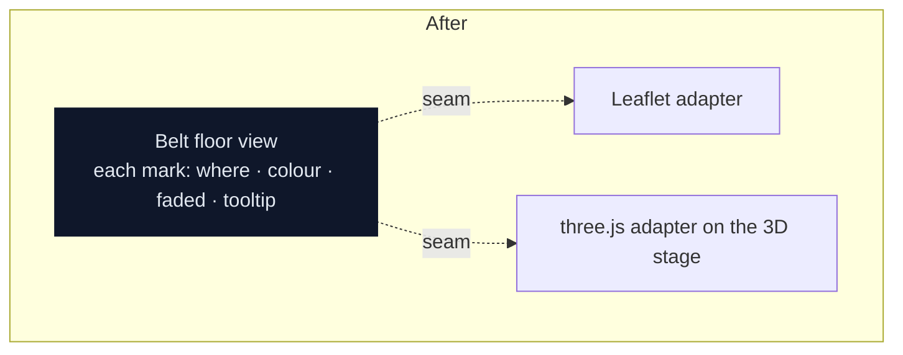
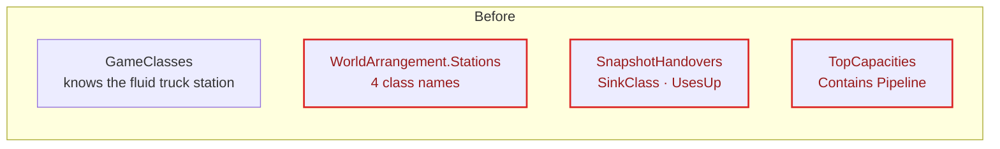
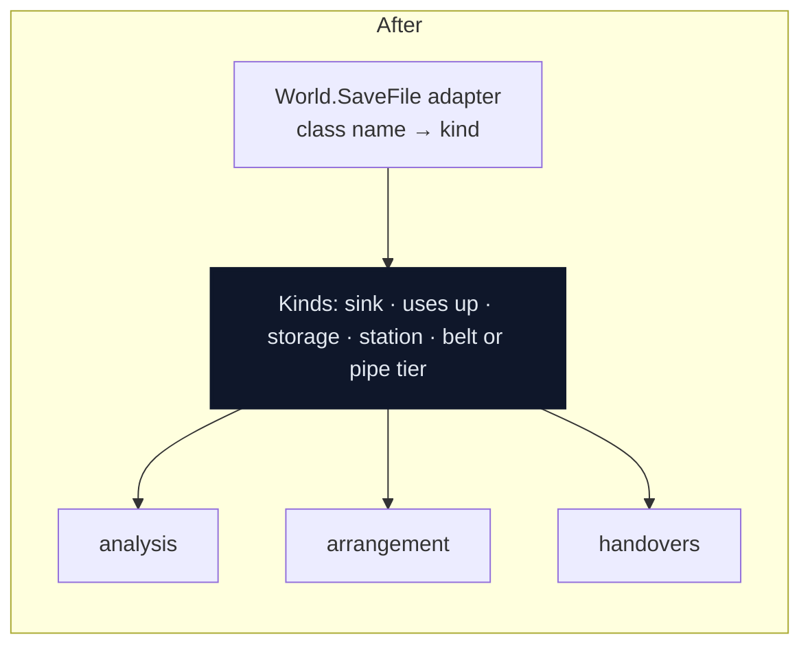

# Architecture review, 2026-11-28

Deepening opportunities, written by `/improve-codebase-architecture` against `main` at `355a17e`. Architecture words come from the `codebase-design` skill (module, interface, depth, seam, adapter, leverage, locality), domain words from `GLOSSARY.md`. Paths without a prefix are under `src/Modules/World/`.

Scope:
- the open cards of the review of 2026-11-26, checked again;
- what has changed since then: the 3D stage, the factory draft, and factories in a snapshot.

## The cards of 2026-11-26

| Card | Status | Where |
|---|---|---|
| 1 · Rates of a buildable | Mostly done. What's left is card **B** below | `Buildable.Demand / Production / Consumes`. Every utilisation default is now `?? 0`, and the traces count generators |
| 2 · One reader of the stored analysis | Done | `AnalysisReadings.Of`, the one place the document becomes `FlowReadings`. `World.Tests` no longer references `World.Simulation` |
| 3 · A factory's handovers | Done | `World.Domain/FactoryHandovers.cs`. `FactoryInputs` and `FactoryOutputs` are projections; 26 tests on `TestReadings` |
| 4 · Factories matched once per snapshot | Done | `SnapshotFactories` (#61, #62) |
| 5 · One 3D stage | Done | `web/src/app/world/stage/` (#68) |
| 6 · The factory draft | Done | `web/src/app/world/factory-draft.ts` (#65) |
| 7 · What the belt floor shows | Open, card **C** | |
| 8 · Consumer kinds at import | Open, card **D** | |

## A · Who owns a shared machine is decided on both sides of the API seam

**Strong** · across the API seam · touches ADR-0025

**Status:** done in step 125 (`docs/guide/log/125-owner-of-a-shared-machine.md`), branch `fix/owner-of-a-shared-machine`.

**Files:**
- Back end: `Factories/SnapshotFactories.cs` (`Of`, the owner map) and `Factories/FactoryEndpoints.cs` (`OrderBy(factory => factory.Name)` at :172 and :195).
- Web: `web/src/app/world/area/factory-outlines.ts` (`machineOwners`, `outlined`).
- The web's callers of `owners.get(id)?.[0]`:
  - `area-page.ts:561`;
  - `arrangement-model.ts:80`;
  - `arrangement-page.ts:395`, `:720`, `:780` and `:840`.
- Uses of the same rebuilt ownership: `factory-draft.ts` (`blocked`) and `map-page.ts:256`.

**Problem.** The back end makes the oldest factory the owner of a machine two factories have (BR-W5: `SnapshotFactories.Of` orders by `StoredFactory.OldestFirst`). The API sends the factories ordered by name and doesn't say who owns what. So the web rebuilds ownership from the machine lists, and takes the alphabetically first factory as owner.

For a machine stored in two factories from before BR-W5, the arrangement's owner and "related factories" can then name a different factory from the one the factory page's handovers count. The outline colour comes from a factory's position in that name-ordered list, so adding or renaming a factory recolours the others.

**Solution.** `SnapshotFactories` stays the one module that decides ownership. The web stops deciding it again: it reads the owner from the API and only shows the overlap.

**Benefits:**
- **Locality:** the owner rule lives in one place, so a change to BR-W5 is one edit.
- **Leverage:** the seven web callers stop choosing an owner.
- **Tests:** the owner rule is tested once, in the back end. The web tests only check how the overlap is drawn.

The colour rule is a separate decision for the owner: by position in the list, or stable per factory.

**Domain:** the model shows different owners in different views, which is likely wrong output today. Verify it first with a failing test on a world where two factories share a machine.

## B · What counts as a generator, and the trace walks

**Worth exploring** · in-process · what's left of card 1

**Files:**
- `World.Domain/Tracing/ShortageTrace.cs` (`Walk` :256-263, `AtFullSpeed`) and `BlockageTrace.cs` (`Walk` :258-265, `Takes`);
- `World.Domain/Tracing/FlowReadings.cs` (:74, :87) and `World.Domain/FactoryHandovers.cs` (`cannotLeave` :273, `Asks` :318, net demand at :113-126 and :246-262);
- `World.Domain/Flow/WorldFlow.cs` (`NodeOf` :92) and `World.Domain/FactoryDefinition.cs` (`CanBeChosen` :30);
- `Analysis/SnapshotAnalysis.cs` (`OnStock` :224-241, `PowerOf` :86) and `Arrangement/WorldArrangement.cs` (:284);
- `Snapshots/SnapshotDocument.cs` (`IsMachineOrGenerator` :178).

**Problem.** The rates at 100% have one home (`Buildable`), but "is this a generator" is asked three ways:
- `Consumer { Generation: not null }`: a generator whose fuel is known (4 places);
- `Consumer { IsGenerator: true }`: any generator (6 places);
- `IsMachineOrGenerator`: on the stored document (`MachineMatch`).

The trace walks still switch by type:
- the shortage walk counts a generator's byproduct as a source even when nothing of it leaves, which `Buildable.Produces` doesn't;
- the blockage walk takes any generator as a consumer of any item.

`InputStock` is declared on both `Machine` and `Consumer`, which forces a switch in `OnStock`. Small copies of the same rule remain as well:
- `FactoryHandovers.cannotLeave` is a hand copy of `FlowReadings.MakesMore`;
- net demand is written out twice in `FactoryHandovers`, with opposite signs;
- three private wrappers spell out "at 100%" again.

**Solution.** `Buildable` answers what the walks and the stock check now find out by switching:
- what it makes;
- what it takes;
- whether it holds stock.

**Benefits:**
- **Locality:** one rule for a generator's byproduct, and one for what it takes.
- **Leverage:** about ten callers stop switching.
- **Tests:** a test per generator rule. Today, three generator trace tests cover two walks.

**Domain:** the two walks may give wrong traces for generators (a byproduct that doesn't leave, an item the generator doesn't burn). Neither case has a test. Check each with a failing test before the refactor, and put the fix in its own `fix:` commit.

## C · One "what the belt floor shows", two adapters

**Worth exploring** · ports and adapters (web) · card 7 of 2026-11-26, unchanged

**Files:**
- `web/src/app/world/arrangement/arrangement-model.ts`: 1045 lines, 52 exports, 111 tests;
- `arrangement-page.ts` (1189 lines; `spotNames` at :1013, `listenForArea` at :647);
- `belt-floor-3d.ts` (632 lines, no spec; `spotNames` at :291);
- `web/src/app/world/map/map-page.ts` (`listenForArea` :449);
- `area-model.ts:23` and `arrangement-model.ts:174` (two `areaBetween`s).

**Problem.** The model's pure functions are deep and well tested, but each renderer stitches six of them together its own way, and that wiring isn't tested. `spotNames` is copied word for word. Choosing an area on the map is also copied, with two different minimum sizes: 200 and 1000 cm.

**Solution.**
- One module describes what the floor shows. The Leaflet view and the three.js view on the 3D stage are its two adapters.
- The settings and the run text move out of the floor model.
- Choosing an area on the map gets one home.

**Benefits:**
- **A real seam:** two adapters, so something actually varies across it.
- **Tests:** the wiring can be tested without WebGL.
- **Leverage:** a change to a mark is one edit, not two.

The 3D stage has made the three.js adapter cheaper than it was on 11-26.

## D · Classify consumers at import, not by class name

**Worth exploring** · in-process · card 8 of 2026-11-26, unchanged · touches ADR-0016

**Files:**
- `Arrangement/WorldArrangement.cs`: `Stations` :41, plus :250 and :415; `TopCapacities` :472 (`tier.Id.Contains("Pipeline")`);
- `Analysis/SnapshotHandovers.cs` (`SinkClass`, `UsesUp` :15-18, and the `buildingOf` map passed into `FactoryHandovers.Of`);
- `World.SaveFile/GameClasses.cs` (`Generators` :22, `Consumers` :32, the fluid truck station at :48);
- `Snapshots/BuildableDocument.cs` :104 and `SnapshotDocument.cs` :180.

**Problem.** Code past the save-file reader still branches on game class names, and the copies disagree. `WorldArrangement.Stations` lists four class names and leaves out the fluid truck station, so the arrangement doesn't count it as a station. "Generator" is defined three times by class name.

**Solution.** The save-file reader classifies each buildable once, into a domain kind. Nothing past `World.SaveFile` reads a class name.

**Benefits:**
- **Locality:** game names live in one adapter.
- **Leverage:** string checks go from four files.
- **Domain:** the kinds become glossary terms.

**Domain:** the fluid truck station is likely missing from the arrangement's stations today. If a kind is stored on the snapshot, the snapshot version goes up (ADR-0016).

## E · Arrangement link-making reads the snapshot again for every factory

**Speculative** · in-process · measure first

**Files:** `Arrangement/WorldArrangement.cs` :188 and `Analysis/SnapshotHandovers.cs` :24-28.

**Problem.** `WorldArrangement` calls `SnapshotHandovers.Of` once per factory. Each call scans `snapshot.Buildables` three times and builds a full map from id to class. Step 120 measured 8.4 to 8.9 s and left part of that unexplained (`docs/guide/log/120-…`). This could be some of it, but nobody has measured it.

**Solution.** The snapshot-wide parts are built once per snapshot, next to `SnapshotFactories`, and each factory's handovers read them.

**Benefits:**
- **Locality:** the per-snapshot work lives in one place.
- **Leverage:** 72 factories × 3 scans become 3 scans.

Card D would remove the class map altogether.

## Seen, not carded

- **The pipe-network flood fill has three copies:** `PipeFlows.HubsOf` :60-74, `PipeHeadLifts` :86-99 and `Pipes/HeadLift.cs` :55.
- **BR-A17 "runs on stock" is decided twice:** in `WorldFlow.Stocked` :193 and in `SnapshotAnalysis.OnStock` :234. One home would need an analysis version (ADR-0017).
- **The sidebar's "still in view" is read from the DOM, and the two pages read it differently:** `area-page.ts:881` queries `app-sidebar`, `map-page.ts:952` queries `app-sidebar .tab`.
- **Three nearly identical deletion services, none with a spec:** `factory-deletion.ts`, `snapshot-deletion.ts` and `arrangement-deletion.ts`.
- **Nothing new in the 3D stage or the factory draft.** `stage.ts` is a real seam with two users. `FactoryDraft` has 17 specs, and its only friction is card A.

## Top recommendation

**A · who owns a shared machine.** It's the only card where the views likely disagree today: one shared machine, two different owners. It's small (one owner field across the API, and seven web callers that stop deciding), and it follows directly from the BR-W5 work of #62.

After that, **B**, because it might hide wrong traces. Each of its two suspect walks gets a failing test first.
