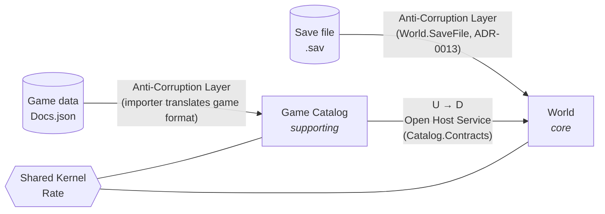

# Context map

U = upstream, D = downstream.

## Contexts

### Game Catalog (supporting subdomain)
- **Responsibility:** the game's facts: items, recipes, buildings, transport tiers.
- **Nature:** reference data, read-mostly. It changes only when you import a new game version.
- **Upstream of everyone.** It offers a stable, published model (*Open Host Service*) through `Catalog.Contracts`.
- **Anti-Corruption Layer:** the `Docs.json` importer. The game's format (class names like `Desc_IronPlate_C`, UTF-16 encoding, fluid amounts ×1000, odd string-encoded arrays) must **never** leak past the importer.

### World (core subdomain, the heart)
- **Responsibility:** the world as built, read from save files: machines, providers, consumers and logistics, and how they're connected. The player's factory definitions on top of it, and the analysis that finds flaws (ADR-0012).
- **Downstream of Catalog.** It needs recipes and belt and pipe capacities.
- **Anti-Corruption Layer:** `World.SaveFile` (ADR-0013). The save format and the library that reads it never leak past it.
- Replaced the Blueprint Design and Factory Network contexts (ADR-0014). Planning comes back later as its own context on top of the World.

### Shared Kernel
- Deliberately tiny: `Rate` (exact items per minute) and perhaps strongly typed IDs that cross contexts.
- **Rule:** a change to the shared kernel affects every context, so it needs an ADR.

## Future contexts (not in v1)

| Context | Why later |
|---|---|
| **Resource Nodes** (miners, purity, extractors) | Deferred. Miners and extractors are providers in the World for now. |
| **Power** | Not needed now. It would consume building power usage from Catalog. |
| **Planning** | Design changes and check them before building them. Returns on top of the World (ADR-0012). |
