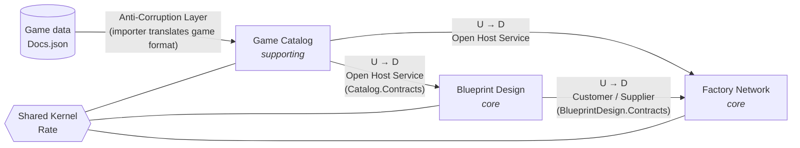

# Context map

U = upstream, D = downstream.

## Contexts

### Game Catalog (supporting subdomain)
- **Responsibility:** the game's facts: items, recipes, buildings, transport tiers.
- **Nature:** reference data, read-mostly. It changes only when you import a new game version.
- **Upstream of everyone.** It offers a stable, published model (*Open Host Service*) through `Catalog.Contracts`.
- **Anti-Corruption Layer:** the `Docs.json` importer. The game's format (class names like `Desc_IronPlate_C`, UTF-16 encoding, fluid amounts ×1000, odd string-encoded arrays) must **never** leak past the importer.

### Blueprint Design (core subdomain)
- **Responsibility:** turning a designer layout into a verified chain of production steps with derived inputs and outputs.
- **Downstream of Catalog.** It needs recipe rates.
- **Upstream of Factory Network.** It publishes "per-copy inputs and outputs of blueprint X" (*Customer/Supplier*: Factory Network's needs shape that contract).

### Factory Network (core subdomain, the heart)
- **Responsibility:** factories (blueprint × stack height), resource supplies, supply lines, line analysis and layout suggestions.
- This is where the spreadsheet falls short today, so it's the main reason the tool exists.

### Shared Kernel
- Deliberately tiny: `Rate` (exact items per minute) and perhaps strongly typed IDs that cross contexts.
- **Rule:** a change to the shared kernel affects every context, so it needs an ADR.

## Future contexts (not in v1)

| Context | Why later |
|---|---|
| **Resource Nodes** (miners, purity, extractors) | Explicitly deferred. `ResourceSupply` is a placeholder that this context will later feed. |
| **Power** | Not needed now. It would consume building power usage from Catalog. |
| **Save Import** | Parse `.sav` files to fill in the world. An ACL like the Catalog importer, but much bigger. |
