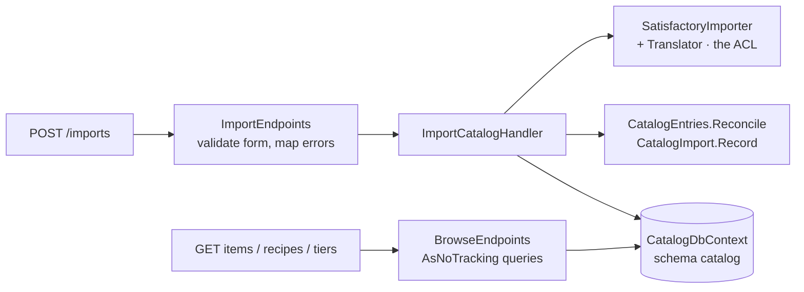

# Step 01 · M2: catalog import, persistence and API

**Milestone:** M2 Catalog ("import the game's Docs file, browse items and recipes via the API").
**Result:** 166 tests green: 56 domain, 51 shared kernel, 32 Catalog, 11 architecture, 16 integration on a real PostgreSQL.
**Decisions you made:** upsert and mark entries the game dropped, upload in the request, game version as a form field (ADR-0009).
**Decisions I made, for you to overrule:** ADR-0010 (no mediator), ADR-0011 (no repositories in Catalog), and the points under "Choices worth a second look".

## What was built

```
POST /api/v1/catalog/imports          multipart: file + gameVersion → 201 + Location, 400, 422
GET  /api/v1/catalog/imports/{id}     200 / 404
GET  /api/v1/catalog/items?form=fluid 200 / 400
GET  /api/v1/catalog/recipes?produces=Desc_IronPlate_C   200, with rates { perMinute, exact }
GET  /api/v1/catalog/transport-tiers  200
```



## How, layer by layer

### 1. Housekeeping first
- **`Rate.FromRecipe` used only numerators.** 1 item per 2.4 s came out as 5/min instead of 25/min. Red test first (`One_item_per_2_point_4_seconds_is_25_per_minute`), then the fix: (a/b) ÷ (c/d) = (a·d)/(b·c).
- **Fixture paths used `\`**, which only works on Windows. CI runs on Linux, so every fixture test would have failed there. They now use `/`.
- **`Rate.ToExactString()`** gives `"45/8"` for the API.

### 2. Domain (`Catalog.Domain`), test-first
- `ICatalogEntry<T>`: `IsInGame`, `UpdateFromGame(fromGame)`, `MarkNoLongerInGame()`. Implemented by `Item`, `Building`, `TransportTier` and `Recipe`. Their properties got private setters, because an update now changes them.
- `CatalogEntries.Reconcile(stored, fromGame)` is ADR-0009 as code: add new entries, update stored ones, mark the missing ones. It refuses a file with the same class name twice. It doesn't report an entry again when it was already marked.
- `CatalogImport.Record(...)`: game version (required), timestamp, counts per kind of entry, and the class names that are no longer in the game.
- Tests: `CatalogEntryTests` and `CatalogImportTests`, 20 behaviours, no database.

### 3. Persistence (`Catalog/Persistence`)
- `CatalogDbContext` in its own schema `catalog`, with snake_case names (`EFCore.NamingConventions`) and its migrations history table in that same schema (ADR-0007).
- The mapping is in `CatalogEntityConfigurations.cs`, so the domain classes have no EF attributes:
  - ids use **value converters** (`ItemId` ⇄ `text`);
  - recipe inputs and outputs are **complex collections** stored as `jsonb`;
  - import counts are **complex properties** stored as columns (`items_added`, …);
  - `NoLongerInGame` is a **primitive collection** stored as `text[]`.
- One migration, `InitialCatalog`, created with `dotnet ef` (now a local tool in `dotnet-tools.json`).
- **What EF Core demanded from the domain:** two small compromises, each with a comment explaining why.
  - `Recipe` and `CatalogImport` got a constructor with only the scalar properties.
  - `Recipe` keeps its ingredients in a private `List<T>` field and exposes `IReadOnlyList<T>`.

### 4. Use case (`Catalog/Imports`)
- `ImportCatalogHandler`: parse and translate (the ACL), load what's stored, `Reconcile`, `AddRange` the new entries, record the import, then one `SaveChangesAsync`. EF's change tracking writes the updates that `Reconcile` made to the loaded entities, so the handler has no update code of its own.
- Parse or translate errors become `InvalidDocsFileException`. The endpoint returns that as **422** with `code: "Catalog.InvalidDocsFile"`.
- Time comes from an injected `TimeProvider`.

### 5. API (`Catalog/Imports`, `Catalog/Browsing`, `Api/Program.cs`, `AppHost`)
- **Minimal API endpoints** in a route group `/api/v1/catalog`, mapped by `CatalogModule.MapCatalogEndpoints()`, the module's only public type (ADR-0003).
- Every endpoint has a name and a summary, and returns `TypedResults`, so OpenAPI knows every status code. Response records are `internal` and separate from the domain.
- Queries read straight from the `DbContext` with `AsNoTracking()` (chapter 04, light CQRS). Recipe rates come from the domain (`BaseInputRates`), so that mapping happens in memory.
- `Program.cs` adds:
  - ProblemDetails;
  - string enums;
  - strict number handling;
  - Scalar at `/scalar/v1`;
  - migrations at startup in Development;
  - a status-code selector so binding errors stay 400.
- The AppHost starts PostgreSQL with a data volume, and hands its connection string to the API.

### 6. Integration tests (`Api.IntegrationTests`)
- `LedgerApiFactory` runs one in-memory API (`WebApplicationFactory<Program>`) and one PostgreSQL container (Testcontainers) for the whole run. It's an xUnit v3 assembly fixture. Each test empties the catalog first. Parallel runs are off, because the tests share one database.
- The tests define their own response records (`CatalogClient.cs`), so a renamed field in the API breaks a test, just like it would break a client.
- 16 tests cover:
  - the full game file;
  - re-import changes nothing;
  - a removed recipe is kept, marked no longer in the game;
  - 400, 404, 415 and 422 responses;
  - the fluid filter;
  - alternates;
  - exact rates, including 2.4 s;
  - tier order.

I also ran the real host by hand against a throwaway PostgreSQL. Uploading `en-US.json` with `curl` gave 201. A second upload gave 0 added and 190 items updated. `/scalar/v1` and `/openapi/v1.json` both load.

## .NET points worth noticing (all now in the primer)

| Topic | Java/Spring equivalent | What's different |
|---|---|---|
| `DbContext` + change tracking | `EntityManager` + dirty checking | Same idea. `AsNoTracking()` is explicit for reads. |
| `dotnet ef migrations add` | Flyway/Liquibase | Migrations are **generated** from the model, not hand-written. |
| Value converter, complex type | `AttributeConverter`, `@Embeddable` | Complex *collections* can be stored as JSON (`ToJson()`). |
| EF and constructors / collections | JPA wants a no-arg constructor | EF binds scalar constructor parameters only. Collections must be `IList<T>` (no arrays, no `IReadOnlyList<T>`). |
| Minimal API binding | Spring argument resolvers | Inferred from type and route. **Enums bind case-sensitively.** |
| `BadHttpRequestException` | — | Thrown in Development, so it becomes a 500 unless you map it. |
| `Results<A, B>` return types | `@ApiResponse` annotations | The return *type* documents the status codes. |
| Antiforgery on `IFormFile` | Spring Security CSRF | On by default for form binding; `.DisableAntiforgery()` for a cookieless API. |
| JSON number handling | Jackson | ASP.NET reads `"5"` as a number by default, so OpenAPI shows `number \| string`. |
| `decimal` scale | `BigDecimal` scale | `"6.000000"` stays `6.000000` in JSON unless you normalise it. |
| Extension methods | Kotlin extensions | Invisible without the right `using`. |
| `catch … when` | multi-catch | A filter on any condition; the stack stays intact. |
| `TimeProvider`, `Guid.CreateVersion7()` | `Clock`, a UUIDv7 library | Built in. |
| Transitive pinning | `<dependencyManagement>` | Opt-in for Central Package Management. |
| `WebApplicationFactory`, assembly fixture | `@SpringBootTest`, JUnit extension | In memory; one fixture per test assembly. |

## Choices worth a second look

1. **Browse endpoints include entries that are no longer in the game**, flagged with `inGame: false`. The alternative is hiding them by default and adding `?includeNoLongerInGame=true`.
2. **The import runs synchronously**, so it answers 201. It takes about a second for the full file. Chapter 05 also allows 202 Accepted with a background job, which isn't worth it at this size.
3. **Concurrent imports aren't guarded.** Two uploads at the same moment can collide on a primary key, which gives a 500. That's fine for a single player.
4. **API enums reuse the domain enums** (`ItemForm`, `TransportForm`). Renaming a domain enum value changes the API. Separate contract enums would decouple them.
5. **The architecture test now skips `*.Persistence.Migrations`**, because `dotnet ef` always generates public classes.
6. **Not done yet:** the committed `openapi.v1.json` with its CI check (ADR-0006), and `ICatalogQueries` in `Catalog.Contracts` for M3. Both would be good next steps.

## Try it

```bash
dotnet run --project src/SatisfactoryLedger.AppHost      # Docker must be running
# open the API's /scalar/v1 from the Aspire dashboard, then POST /api/v1/catalog/imports
# with en-US.json from <game>/CommunityResources/Docs and gameVersion=1.1
```
