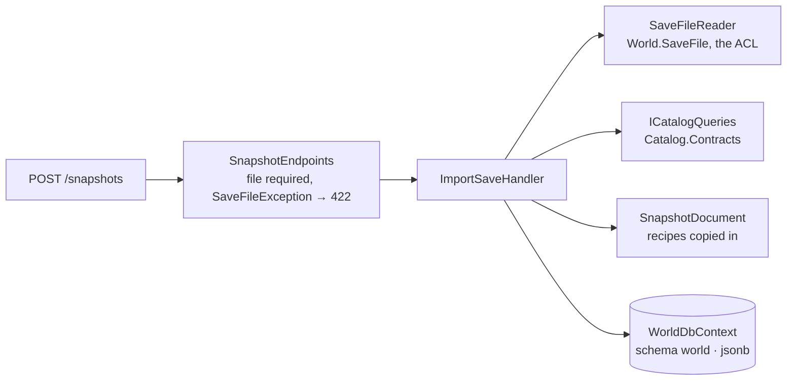

# Step 08 · World: importing a save as a world snapshot

**Goal:** make the World usable through the API. Upload a save, resolve its recipes through the Catalog, and keep it as a snapshot (BR-W10). This is also where `ICatalogQueries`, announced in step 01, finally gets built.
**Result:** `POST /api/v1/world/snapshots` imports a save, and `GET` lists snapshots or reads one back. 17 new tests, all green: 8 unit tests for the snapshot document, 2 integration tests for the Catalog query and 7 for the World API. Solution total: 301 green, on PostgreSQL with Docker. Your big world reads in 11 s, and its snapshot document is 12 MB of JSON.
**Decisions you made:** one document per snapshot (ADR-0016). Import and report what the Catalog doesn't know (BR-W10). Push the second library fix to your fork (pin `b85249a`).
**Decisions I made, for you to overrule:** see "Choices worth a second look".

## What was built

```
POST /api/v1/world/snapshots       multipart: file (.sav) → 201 + Location, 400 (no file), 422 (not a save)
GET  /api/v1/world/snapshots       all snapshots, newest first (without content)
GET  /api/v1/world/snapshots/{id}  one snapshot: saved and imported at, counts, unknown recipes, unsupported → 200 / 404
```



| Project | Change |
|---|---|
| `Catalog.Contracts` | `ICatalogQueries.GetRecipesAsync(ids)`, returning `CatalogRecipe` and `CatalogIngredient`: plain records with class names, amounts and cycle time. |
| `Catalog` | `Queries/CatalogQueries` implements it on `CatalogDbContext`, registered in `AddCatalogModule`. |
| `World` | `Snapshots/SnapshotDocument` (the stored form, with `Create`, `ToJson`/`FromJson`, `Counts`, `ToWorldGraph`), `Snapshots/ImportSave` (the use case), `Snapshots/SnapshotEndpoints`, `Persistence/WorldDbContext` with `StoredSnapshot`, migration `InitialWorld`, and `AddWorldModule`/`MapWorldEndpoints`/`MigrateWorldDatabaseAsync`. |
| `Api` | Registers and maps the World module, and migrates its schema in Development. |
| Tests | New `World.Tests` project. `CatalogQueriesTests` and `WorldSnapshotApiTests` in the integration tests. The test world is linked into both from the adapter's tests. `LedgerApiFactory.ResetAsync` empties every module's tables, taken from each DbContext's model. |
| Fork | `b85249a`: per-string tracing in Debug builds is opt-in. ADR-0013 amended. |
| Docs | ADR-0016, BR-W10, glossary *World Snapshot*. |

## How

### 1. The stored form: a document of our own (ADR-0016)
`SnapshotDocument` is a set of plain records:
- the buildables, with role, class, recipe, clock as a percent, boost, node and logistics kind;
- the connections;
- the recipes used, copied from the Catalog;
- the unknown recipes;
- the unsupported classes.

It's serialized with System.Text.Json into one `jsonb` column of `world.snapshots`. The columns next to it (session, build, saved and imported at, counts, unknown recipes, unsupported) let lists and details skip the 12 MB content. `ToWorldGraph()` builds the domain's graph from the document. The domain stays free of persistence.

### 2. BR-W10 in code
- **Recipes are looked up and copied in at import.** `SnapshotDocument.Create(saved, catalogRecipes)` copies only the recipes the save's machines use, and lists the rest as unknown.
- **A machine with an unknown recipe stays in the world without items.** In the graph it's `new Machine(id, [], [])`.

### 3. The Catalog behind its contract
- **The World module only sees `Catalog.Contracts`.** The query takes class names and returns records of strings and decimals. The Catalog's domain types and its `Rate` stay inside the Catalog: contracts depend on nothing (architecture rule 3).
- **The World computes rates itself** from amount and cycle time, when the flow analysis needs them.

### 4. Tests that can fail
- **All 17 tests passed on their first run.** So I broke BR-W10 on purpose: unknown recipes not listed. Exactly the two tests named after it failed, the unit test and the API test.
- **The big world, measured in a Debug build:** read 11.0 s, document 0.2 s (12 MB), back into a graph 0.5 s.

## The detour: a Debug build that took more than 5 minutes

Measuring your big world in a test (a Debug build) didn't finish in 10 minutes, while the adapter took 12 s in Release. The cause was in the library: in `#if DEBUG`, `StringSerializer` took two full stack traces, with file and line, for **every string** it read, and logged them. We build the library from source, so it gets our configuration, and `dotnet run` and Aspire build Debug.

First I tried to force the library to Release from our side:
- **`SetConfiguration="Configuration=Release"` on the `ProjectReference`:** works when the adapter is built on its own, but MSBuild ignores it in a **solution** build for projects that aren't in the solution.
- **`PrivateAssets="all"` on the `ProjectReference`:** stops the reference flowing on, but also the library's own NuGet packages. At runtime `Microsoft.IO.RecyclableMemoryStream` was missing.
- **The library in the `.slnx` with `<BuildType Solution="Debug|*" Project="Release" />`:** works for solution builds, but not when a single project is built, as Aspire does.

So the fix went into the fork, with your OK. The tracing now only compiles in with `TRACE_STRINGS`. All three workarounds are gone. A Debug read of your big world now takes 13 s.

## .NET points worth noticing (all now in the primer)

| .NET | Java/Spring (TypeScript) | Note |
|---|---|---|
| A type in the current namespace beats one imported with `using` | In Java, a single-type import shadows a type in the same package | The test namespace's own `CatalogRecipe` hid the contract's. A `using Contracts = …;` alias makes it explicit. |
| `required` + `init` properties (`StoredSnapshot`) | Kotlin non-null `val` in a constructor | `new StoredSnapshot { … }` doesn't compile until every `required` property is set. Immutable after creation. |
| `ProjectReference` metadata: `SetConfiguration`, `PrivateAssets` | Maven `<scope>` on a module dependency | `SetConfiguration` is ignored in solution builds. `PrivateAssets="all"` also drops the referenced project's packages at runtime. |
| `#if DEBUG` in a library built from source | — | It's compiled with **your** configuration, so a library's debug-only code runs in your Debug builds. |
| `jsonb` column via `HasColumnType("jsonb")` on a `string` | `@Column(columnDefinition = "jsonb")` | We serialize ourselves; EF stores the text and PostgreSQL compresses it. |

## Choices worth a second look

1. **`StoredSnapshot` is a persistence record, not a domain entity.** The domain's concept is the graph, built from the document on load. A domain `WorldSnapshot` can come when it gets behaviour, for example comparing two snapshots.
2. **The import runs synchronously** and answers 201. A big save takes about 12 s, like the Catalog import (step 01). 202 Accepted with a background job is the alternative once that bothers you.
3. **Upload size:** Kestrel accepts request bodies up to 30 MB by default. Your big save is 19 MB. Larger worlds need the limit raised for this endpoint. I haven't done that yet, because I haven't verified how minimal APIs apply a per-endpoint limit.
4. **Memory:** reading a big save takes about 1 GB in the API process for those seconds (ADR-0013).
5. **No endpoint returns the graph or a trace yet.** That comes with factory definitions: store a definition, then trace it in a snapshot.
6. **The recipe document includes amounts and cycle times,** which nothing uses yet. The flow analysis will, and a snapshot must carry them from import (ADR-0016).
