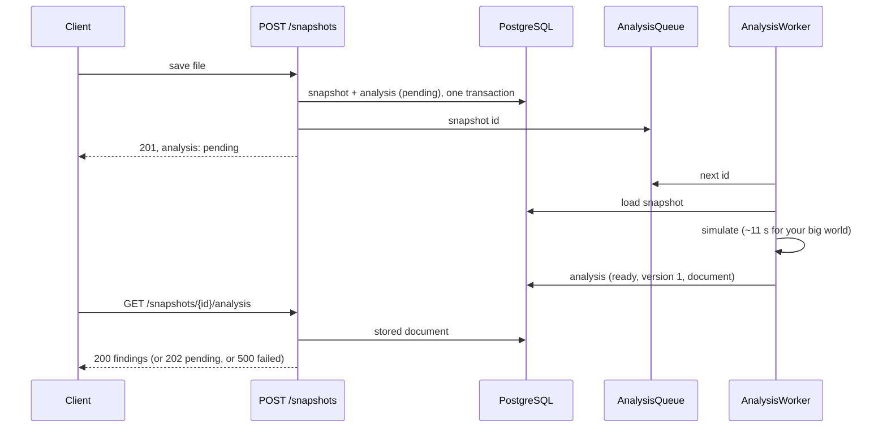

# Step 18 · The analysis, stored and computed in the background

**Goal:** findings without waiting seconds per view. A snapshot never changes, so its analysis can be computed once and stored.
**Result:**
- **The import** returns as before (11.8 s for your big world).
- **The analysis:** a background worker computes and stores it. For your big world that takes 11 s, so the findings are ready about 12 s after the import.
- **Viewing** the world's findings then takes 0.47 s, instead of a new simulation each time. A factory's findings come from the same stored result.
- **Tests:** 542, green twice in a row.

**Decisions you made:** in the background after import (ADR-0017).
**Decisions I made, for you to overrule:** see "Choices worth a second look".

## What was built

```
Analysis/AnalysisDocument    the stored result: machine states, findings, unsettled parts, flow into every belt
Analysis/StoredAnalysis      world.snapshot_analyses: status (pending · ready · failed), version, duration, error, jsonb
Analysis/AnalysisWorker      AnalysisQueue (Channel<Guid>) · AnalyseSnapshotHandler · AnalysisWorker (BackgroundService)
Analysis/SnapshotAnalysis    the world's and a factory's findings, made from the stored document
Snapshots                    the import writes a pending analysis in the same transaction, then queues the snapshot;
                             a snapshot (and the list) says its analysis status
Migration                    AddSnapshotAnalyses
```

## How it works



- **At startup**, the worker queues every snapshot without a current analysis:
  - still pending;
  - failed, maybe for a reason that's gone;
  - computed with an older version;
  - imported before this step.

  The in-process queue loses nothing on a restart, because the database says what's left.
- **The analysis version** (`AnalysisDocument.CurrentVersion`, now 1) must go up when a change to the analysis rules changes results. Then every snapshot is analysed again at the next start. A stored analysis with an older version counts as pending, so the API never serves stale findings.
- **The endpoints** answer 200 with the findings, 202 Accepted with `{ "status": "pending" }`, or a 500 problem with code `World.AnalysisFailed` and the reason.

**One fix along the way.** `FlowResult.Into` walked every connection for each belt it was asked about. Storing the flow into all 38,000 belts of your world made that 1.7 billion steps, and the analysis took 29 s instead of 11. It now looks up the connections into each buildable once.

## Tests (one behaviour each)

| Where | Tests |
|---|---|
| `WorldAnalysisStorageTests` (real PostgreSQL) | A new snapshot says its analysis is pending · it's computed in the background and stored with its version · while pending the API answers 202 · a failed analysis is a problem with its reason · at startup, outdated and failed analyses are queued again |
| `SnapshotAnalysisTests`, `FactoryAnalysisTests` | Unchanged, but now made from the stored document after a JSON round trip (`TestWorldAnalysis`) |
| `WorldAnalysisApiTests` | Wait for the background worker first (`WaitForAnalysisAsync`) |

**Pending and failed are tested without racing the worker:** the test copies an imported snapshot straight into the database, with an analysis in the state it needs. The worker is never told about the copy.

## .NET points worth noticing (all now in the primer)

| .NET | Java/Spring (TypeScript) | Note |
|---|---|---|
| `BackgroundService` + `AddHostedService<T>()` | A `SmartLifecycle` bean, or `@Async` with a task executor | Started and stopped with the host; `ExecuteAsync` gets a token that's cancelled at shutdown. |
| `Channel<T>` | A `BlockingQueue`, or a reactive `Sinks.many()` | An async producer/consumer queue: `await foreach (var id in reader.ReadAllAsync(token))`. |
| `IServiceScopeFactory` in a singleton | `ObjectProvider<T>` / a prototype bean from a singleton | A hosted service is a singleton, and a `DbContext` is scoped. Take a new scope per piece of work; injecting the `DbContext` directly would be a captive dependency. |
| `[LoggerMessage]` on a `partial` method | SLF4J with placeholders | A source generator writes the logging code, with no boxing or formatting when the level is off. The analyzer CA1848 recommends it. |
| `TypedResults.Accepted(uri, value)` | `ResponseEntity.accepted()` | 202 with a body and a `Location` to ask again. |

## Choices worth a second look

1. **One analysis at a time.** Fine for one player. More readers on the same channel later, if needed.
2. **A pending analysis that's asked for is queued again** (if it's outdated or missing). The handler skips a snapshot that's already current, so a duplicate costs one database read.
3. **The stored document holds the flow into every belt that carries something:** 2.4 MB for your big world. That's what lets a factory defined later be analysed without simulating.
4. **A failed analysis is retried at every start.** If it fails for good, it fails at every start, and that's in the log.

## Next

The web app, then the WPF app.
