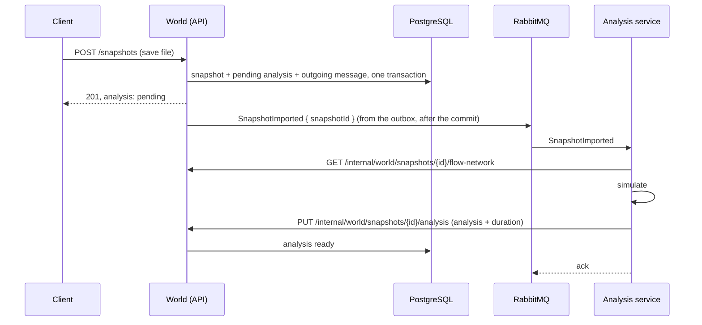

# Step 19 · The analysis as a separate service, over RabbitMQ

**Goal:** a showcase for messaging and a second service. The background worker of step 18 becomes its own deployable, triggered by a message.
**Result:**
- **The flow:**
  1. The import publishes `SnapshotImported` through Wolverine's transactional outbox to RabbitMQ.
  2. `SatisfactoryLedger.AnalysisService` picks it up and fetches the snapshot's flow network from World's internal API.
  3. It simulates the network and sends the analysis back.
- **World stores the analysis as before**, and the findings endpoints are unchanged. So is the public OpenAPI contract.
- **Tests:** 551, green twice in a row. The integration tests run the whole path, with RabbitMQ in a container and the service in the same process.

**Decisions you made (ADR-0018):**
- step 18 committed first, as the baseline;
- RabbitMQ with Wolverine;
- a stateless compute service: World keeps the data;
- the documents go over the API, not through the broker.

**Decisions I made, for you to overrule:** see "Choices worth a second look".

## What was built

```
World.Simulation (new library, shared)   SnapshotImported · FlowNetworkDocument · AnalysisDocument (moved) · AnalysisResult
                                         · AnalysisMessaging (queue and service names)
AnalysisService (new deployable)         Wolverine listener on world.snapshots-to-analyse · SnapshotImportedHandler
                                         · WorldClient (typed HttpClient, service discovery)
World                                    publishes through IDbContextOutbox · AnalysisRequeue at startup
                                         · /internal/world/snapshots/{id}/flow-network, …/analysis, …/analysis/failure
                                         · the in-process worker and its Channel are gone
AppHost                                  RabbitMQ (with management UI) · the analysis service, referencing the API
Tests                                    a RabbitMQ container; the service as a second host next to the API
```

## How it works



- **The outbox.** `IDbContextOutbox<WorldDbContext>` takes the snapshot, its pending analysis and the message in one transaction. Wolverine stores the message in its own tables (schema `wolverine`) and sends it to RabbitMQ after the commit. If the process dies in between, Wolverine sends it at the next start.
- **The service** listens *inline*: a message is handled as it arrives, one at a time, and RabbitMQ gets its ack only after the handler is done. A crash during a simulation leaves the message on the queue. Wolverine's default for RabbitMQ, *buffered*, would take it into memory first.
  - A failing simulation is reported to World as a failure, with its reason.
  - A failing call to World is left to Wolverine to retry. RabbitMQ only gets its ack when the handler succeeds.
- **The internal endpoints** are excluded from the OpenAPI document, so they're not part of the public contract. There's no authentication yet (see "Choices").
- **At startup** World publishes `SnapshotImported` for every snapshot without a current analysis (`AnalysisRequeue`), as before.

## What it took (the surprises)

1. **Wolverine 6.62 needs `WolverineFx.RuntimeCompilation`.** Wolverine generates its handler code at startup. Since 6.x, the Roslyn compiler for that is a separate package, and without it the host refuses to start. The error says so clearly; docs for older versions don't.
2. **The build-time OpenAPI generation (ADR-0006) starts the whole host**, without a database or RabbitMQ. Wolverine then refuses to start for lack of connection strings.
   - `Program.cs` leaves Wolverine out while the generator runs: it runs as the entry assembly `GetDocument.Insider`.
   - Endpoints that take `IMessageBus` say `[FromServices]`. Without Wolverine, the minimal API would otherwise take the parameter for a request body.
3. **Aspire's retries and the outbox don't mix.** `EnrichNpgsqlDbContext` turns on EF's retrying execution strategy, which refuses transactions it didn't start. The outbox opens one as soon as the import publishes.
   - Wrapping the save in `CreateExecutionStrategy()` was too late.
   - The fix: `DisableRetry = true` for the World `DbContext`. Wolverine retries the messaging itself.
4. **Wolverine won't look up services in its generated code by default.** A typed `HttpClient` is made by a factory, so it can't be built inline. `CodeGeneration.AlwaysUseServiceLocationFor<WorldClient>()` allows it for that one type.
5. **Two `Program` classes.** The service's top-level statements made a second public `Program` next to the API's, and `WebApplicationFactory<Program>` became ambiguous. The service now has an explicit `internal static class Program`.
6. **The duration** of the simulation is now measured where it runs: the service sends it back with the analysis (`AnalysisResult`).

## Tests (one behaviour each)

| Where | Tests |
|---|---|
| `FlowNetworkDocumentTests` (new project) | A network read back from its document simulates the same · a belt without a limit keeps having none · ports, rules, priorities, stock and fuel survive · the message carries only the snapshot id |
| `WorldInternalApiTests` | The flow network has every node of the world · an analysis sent back is stored and the findings are ready · a failure sent back is stored with its reason · an unknown snapshot has no flow network · the internal endpoints aren't in the public contract |
| `WorldAnalysisStorageTests`, `WorldAnalysisApiTests` | Unchanged: they now run the real path through RabbitMQ and the service |

## .NET points worth noticing (all now in the primer)

| .NET | Java/Spring | Note |
|---|---|---|
| Wolverine handler: a class named `…Handler` with `HandleAsync(TMessage, services…)` | `@RabbitListener` method | Found by convention. The services are parameters, and Wolverine generates the glue code at startup. |
| `IDbContextOutbox<T>`: `PublishAsync` + `SaveChangesAndFlushMessagesAsync` | A transactional outbox with Spring Modulith or Debezium | Data and message in one transaction; sent after the commit. |
| `AddHttpClient<WorldClient>()` + `https+http://api` | `@LoadBalanced RestClient` + Eureka | A typed client, and Aspire's service discovery picks the scheme and port. |
| `ExcludeFromDescription()` on a route group | `@Hidden` (springdoc) | Leaves endpoints out of the OpenAPI document. |
| `Assembly.GetEntryAssembly()?.GetName().Name == "GetDocument.Insider"` | (Springdoc runs at runtime) | Knowing you're in the build-time OpenAPI generation. |
| `internal static class Program` with `Main` | `public static void main` | Instead of top-level statements, so two apps' `Program` classes don't clash. |

## Choices worth a second look

1. **No authentication on `/internal/world`.** Fine locally under Aspire; a real deployment would add a client certificate or a service token, and keep the routes off the public ingress.
2. **No retries on the World `DbContext`** any more. A transient database error fails the request instead of being retried. Wolverine covers the messaging.
3. **The service handles one message at a time** (inline). More instances can listen on the same queue to analyse in parallel.
4. **The tests run the service in-process**, against the API's in-memory test server. That's the real Wolverine and RabbitMQ path, but not the network between them.
5. **Under Aspire, after you trusted the certificate:** the Catalog fixture, the node table and the test world imported through `https://localhost:7044`. The snapshot went from *pending* to *ready* within a second, through the outbox, RabbitMQ, the service and back. Its findings are the tests' own: 5 machines, 3 at 100%, 1 starved, 1 blocked.

## A Postman collection

`api/postman/` has a collection of the public API's 19 requests and an environment (`baseUrl` = `https://localhost:7044`, where Aspire publishes the API):
- **The order of use:** Catalog, a save, waiting for its analysis, a factory, its findings.
- **Variables are picked up as you go:** requests store what later ones need (`snapshotId`, `world`, `outputBelt`, `factoryId`), so the collection runs top to bottom in the Collection Runner.
- **"Wait for the analysis"** repeats itself every two seconds until the analysis is ready.
- **The uploads** point at the repo's fixtures, relative to the repo root: set Postman's working directory to the repo, or pick the files by hand.

## Next

The web app, then the WPF app.
