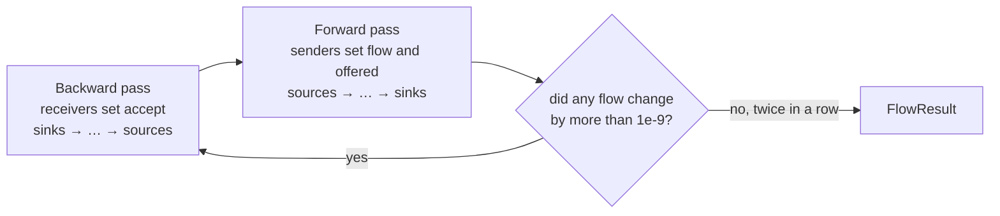

# Flow: the steady-state simulation

This folder answers one question about a world: **once everything has run long enough to settle, how much flows over every belt and pipe, and how hard does every machine work?** The findings come from that answer: starved and blocked machines, bottlenecks, and unused supply.

The rules it implements are BR-A1 to BR-A13 in [`docs/domain/business-rules.md`](../../../../../docs/domain/business-rules.md). Step logs 12 to 15 (`docs/guide/log/`) tell how it was built. This README explains how it works.

| File | What's in it |
|---|---|
| `FlowNetwork.cs` | The model: the kinds of node, what they carry, and the network of nodes and connections. |
| `WorldFlow.cs` | From the world to the model: which kind of node each buildable becomes. |
| `SteadyState.cs` | The simulation: two passes, repeated until nothing changes. |
| `FlowResult.cs` | What comes out: flows, machine states, and the findings. The API gives them per snapshot: `World/Analysis/SnapshotAnalysis.cs`, `GET /api/v1/world/snapshots/{id}/analysis`. |

---

## 1. The model

A `FlowNetwork` is a set of **nodes** and directed **connections** (`Connection(From, To)`: items move from `From` to `To`). Every node is one of seven kinds. Each says what it asks, offers or carries **per minute**:

| Node | In the world | What it knows |
|---|---|---|
| `FlowProvider` | Miner, oil, water or resource well extractor | `Item`, `Offer`: what it can deliver (BR-A2) |
| `FlowUnknownSource` | A station that unloads (train platform, drone port, truck station); a container nothing feeds; an extractor on a node the Catalog doesn't know | `Stock`: what it holds now (BR-A9); `Burns`: the fuel of a drone port or truck station (BR-A8) |
| `FlowMachine` | Smelter, constructor, … | `Demand` and `Production` per item at 100% (BR-A1) |
| `FlowConduit` | Belt, lift, pipe; a container inside a line | `Capacity` (BR-A3); a container passes through with an unlimited capacity |
| `FlowSplitter` | Splitter, smart splitter, pipe junction | `Rules`: a smart splitter's rules per output (BR-A4); none: it divides evenly (BR-A4, A6) |
| `FlowMerger` | Merger, priority merger | `Priorities`: a priority merger's priority per input; none: it takes evenly (BR-A5) |
| `FlowSink` | AWESOME Sink, depot uploader, generator, a station that only loads, a container at the end of a line | It takes everything (BR-A7, A8); `Burns`: a loading truck station's fuel |

Conduits, splitters, mergers and unknown sources also say what they **carry**: `Carries.Solids` or `Carries.Fluids` (section 2b). The network knows which items are fluids (`FlowNetwork.Fluids`).

Rates are `double`s. The inputs are exact elsewhere, but a steady state with loops only comes closer step by step and may never land on an exact fraction (ADR-0004, amended). Results are meaningful to `SteadyState.Tolerance` = 0.0001/min.

### From the world to the model

`WorldFlow.From(world, fluids)` turns a `WorldGraph` into a `FlowNetwork`. A stored snapshot does it in one call, `SnapshotDocument.ToFlowNetwork()`, with the rates and fluids it copied from the Catalog at import (ADR-0016). The rates themselves are worked out in the domain, exactly, before they become doubles here:
- `Machine.Demand` = recipe rate × clock speed;
- `Machine.Production` = that × production boost (BR-A1);
- `ItemOffer.Extracting` = extraction rate × purity × clock speed (BR-W9).

| Buildable | Becomes | Carries |
|---|---|---|
| `Machine` | `FlowMachine` | (its lines decide) |
| `Provider` with an offer | `FlowProvider` | its item's form |
| `Provider` without one | `FlowUnknownSource` (BR-A9) | (its line decides) |
| `Consumer` | `FlowSink` | (its line decides) |
| Belt, lift | `FlowConduit` with its tier's capacity, or no limit if the Catalog doesn't know the tier | solids |
| Pipe, pump, valve | `FlowConduit` with its tier's capacity; a pump or valve has no tier, so no limit | fluids |
| Splitter, merger | `FlowSplitter`, `FlowMerger` | solids |
| Pipe junction | `FlowSplitter` (BR-A6) | fluids |
| Storage container, fluid buffer | at the end of a line `FlowSink`; inside a line `FlowConduit` without a limit; fed by nothing `FlowUnknownSource` (BR-A7, A9) | solids / fluids |

The tests build small networks by hand with `TestFlow`, or small worlds with `TestWorld`.

---

## 2. Three numbers on every connection

The simulation keeps three things per connection (*edge* in the code). Everything else follows from them.

```
            offered: what the sender would send if the receiver took everything
  sender ─────────────────────────────────────────────────────────────▶ receiver
            flow:    what actually goes over it
            accept:  how much the receiver can take
```

| | Kept in | Set by | Used for |
|---|---|---|---|
| **accept** | `_accept[edge]` (a number, ∞ at the start) | the **receiving** end, in the backward pass | Back-pressure: the sender never sends more than this |
| **flow** | `_flow[edge]` (per item) | the **sending** end, in the forward pass | The answer: what goes where |
| **offered** | `_offered[edge]` (per item) | the **sending** end, in the forward pass | Telling *why*: starved or blocked, bottleneck or not |

Why **offered** next to **flow**? Back-pressure lowers the flow on *both* sides of a machine.
- **A blocked machine:** its output can't leave, so it stops, so it takes nothing in, so its input flow drops to zero too. From flows alone it looks starved. Its input is still *offered*, though, so the cause is visible: offered enough, but the output takes less, means *output blocked*.
- **A machine with two inputs:** if each input's acceptance looked at what the other has *delivered* so far, both would start at zero and wait for each other forever. Looking at what the other is *offered* breaks that.

### 2b. Solids and fluids

A connection carries what both its ends allow: a belt only solids, a pipe only fluids. A machine, a sink or a station allows anything, so its line decides (`Both` in the solver). That matters in four places:
- **`Send` divides solids and fluids separately.** Each form goes over the outputs that carry it. A refinery's plastic goes on its belt and its residue in its pipe.
- **`OutputRoom` takes the tighter form.** A refinery whose residue has no pipe to leave by can't run: *output blocked* on the residue.
- **`AcceptForMachine`** only expects the items its line can bring.
- **An unknown source** only supplies what its line can carry. A container next to a packager sends canisters, not water.

### 2c. Spare: fuel for drones and trucks

A drone port or truck station burns fuel, but the save doesn't say how much (step 14). So it takes its fuel only from what the line's other consumers leave (BR-A8). Next to **accept**, each connection has **spare** (`_spare`): what it takes only when there's some left.
- **A station** (`TakeEverything`) sets spare ∞ and accept 0 on an input whose items are all fuel it burns (`Burns`, from its fuel slot). On every other input, accept ∞.
- **Belts, splitters and mergers** pass both on: accept as before, spare up to what the belt has left (`Left`).
- **`Send`** fills what the outputs accept first, and gives the rest to spare.
- **A machine** counts spare as room for its output, so a packager making rocket fuel only for a drone port still runs.

Rocket fuel split between a generator burning 40 and a drone port: the generator gets its 40, the port the 20 left. With accept ∞ for the port, they'd get 30 each.

### 2d. Smart splitters

A connection knows its **port**: which output of a splitter it leaves from (`FlowNetwork.Ports`, from the save's `Output1`, `Output2`, `Output3`, counted from 0). A splitter with `Rules` sends through `SendSorted`:
- **The outputs that take an item:** its own item rule, *any*, or *any undefined* when no other output names it. The item is divided evenly over those, as far as they take it.
- **What they can't take** goes to the outputs set to *overflow*.
- **An output set to *none*** gets nothing.

Items going to the same outputs are sent together; groups are served one after the other. In the backward pass, a smart splitter passes on only what its receiving outputs accept.

Of your world's 212 smart splitters, 182 have saved rules, and all but one of those are overflow setups: *any* to the factory, *overflow* to a sink. Before step 15 they divided evenly, so the sink got at least half.

### Why an unknown source offers its belt

A provider offers its rate even when nothing takes it yet. A source of unknown rate first offered only what was accepted. Take a blender whose casings come from one station and its heavy frames from another:
- it takes casings only as far as frames are offered (`ScarcestOtherThan`), and frames only as far as casings are offered;
- so neither station was offered any room, and both stayed at 0.

It now offers what its belts can carry (`CanCarryAtMost`), as BR-A9 says. On your big world, that brought 19 silent stations to life.

---

## 3. One sweep: backward, then forward

`Run()` repeats a **sweep** until nothing changes. A sweep is two passes over all nodes:



The order is worked out once (`ForwardOrder()`): a **topological order**. A node comes only after everything that feeds it, so one forward pass carries a change all the way down a line, and the backward pass, walking the order in reverse, carries one all the way up. A loop has no such order: when only loops are left, the first node of one goes next, and the rest follows from it.

The order matters more than it looks. Step 12 used a breadth-first order. There, a node reached by a short and a long path was handled before the long path had updated, so it worked with numbers one sweep old. On your big world, two blenders flip-flopped between two states because of that and never settled. The test `A_branch_that_rejoins_the_line_settles_in_one_sweep_and_two_that_confirm_it` shows the difference: 3 sweeps instead of 4.

### Backward pass: what each receiving end can take

Every node sets `accept` on its **incoming** connections:

| Node | Accept on its inputs |
|---|---|
| Sink, station | ∞; the fuel it burns: 0, but spare ∞ (section 2c) |
| Conduit | `min(Capacity, what its outputs accept together)`; a belt that ends nowhere accepts 0 |
| Splitter | what its outputs accept together |
| Merger | what its output accepts, **shared** over its inputs (see `ShareInputs` below) |
| Machine | per input item, `demand × min(output room, scarcest other input)`, **shared** over the connections that bring that item like a merger's inputs. A connection bringing an item the machine doesn't ask for gets 0: it clogs. |
| Provider | (no inputs) |

**Output room** (`OutputRoom`) is the share of 100% a machine's outputs can take: `min(1, (accepted + spare) downstream ÷ total production)`. **Scarcest other input** (`ScarcestOtherThan`) is the lowest `offered ÷ demand` over the machine's *other* inputs. A machine can only use as much of one input as its other inputs allow.

**`ShareInputs`** is used by conduits, splitters and mergers with more than one input. It divides what the node can pass on (`available`) over its inputs like a merger does: `Waterfill` by what each input *offers*. Then each input may take what the others leave: `accept_k = available − (what the others take)`. So an input that offers more next sweep can grow into room the others don't use. It does this twice: for what is accepted, and for what is spare. A **priority merger** shares by priority (`Share`, `PriorityOf`): the inputs with the highest number first, evenly among themselves, and what's left to the next priority down (BR-A5).

A machine shares each input item over its belts the same way. Step 13 had "demand minus what the other belts bring". With two belts bringing the same item, both read last sweep's numbers and swapped every sweep: if the other brought a lot, take nothing; if it brought nothing, take everything. On your big world, a part of 15,328 buildables flip-flopped like that for 2,000 sweeps. Sharing like a merger settles it in 21.

### Forward pass: what each sending end sends

Every node sets `flow` and `offered` on its **outgoing** connections, through `Send`:

| Node | Sends |
|---|---|
| Provider | its `Offer` of its item |
| Unknown source | what its outputs accept, of the items asked downstream, in proportion to what the machines there ask. It **offers** what its belts can carry (BR-A9). |
| Conduit, splitter, merger | what came in |
| Machine | `production × utilisation` (and offers `production × offered share`) |
| Sink | (no outputs) |

**`Send`** divides what a node sends over its outgoing connections with `Waterfill`, by what each one *accepts*. That's the even split of BR-A4. What's left after that goes to the connections that take *spare* (section 2c). Each output is then **offered** what the node offers in total, minus what the *other* outputs take. That's what this output could get if it took everything.

A **machine** works out three shares (`Run`):
- `inputs`: lowest `supplied ÷ demand`, over what actually arrives;
- `offeredShare`: lowest `offered ÷ demand`, over what's offered;
- `outputs`: `OutputRoom`.

Its **utilisation** is `min(inputs, outputs)`. If that's below 100%, the cause is read from what's offered (BR-A11):
- `outputs < offeredShare`: enough is offered, but the outputs take less → **output blocked**;
- otherwise: too little is offered → **starved**, of the item with the lowest offered share.

A machine with no demand and no production has no recipe the analysis knows: **no recipe**, 0%.

### Waterfill: dividing evenly with limits

`Waterfill(total, caps)` divides `total` evenly over receivers that take at most `caps[k]` each. What one can't take goes to the others, like pouring water into glasses of different heights:

```
total 60 over caps [20, 40]:  20 each → the first is full at 20 → the remaining 20 go to the second → [20, 40]
total 60 over caps [30, 60]:  30 each → the first is full at 30 → nothing left over → [30, 30]
```

The splitter's even split, a merger's even take, and what a belt passes on are all the same function.

### Settling

`SteadyState.Of` first splits the network into its **connected parts** (`PartsOf`, ignoring direction) and simulates each on its own. A world is hundreds of separate factories, and each settles at its own pace.

After each sweep, `Run` compares every connection's total flow with the previous sweep. If no flow changed by more than `Tolerance` (0.0001/min, BR-A10) **two sweeps in a row**, the part has settled. A part that hasn't settled after `MaxSweeps` (2,000) sweeps stops anyway. Its `FlowPart.Settled` is false, so its numbers are *approximate*, and `FlowResult.Settled` is false. It never pretends. (`Settle`, 10⁻⁹, is only for comparing doubles inside the solver.)

**Damping.** A part that hasn't settled after `DampAfter` (50) sweeps may be flip-flopping: each connection jumps between two values, because what one manifold offers a machine depends on its neighbour, which depends on another manifold. From then on, `Damp` lets what a connection accepts move only halfway towards its new value each sweep. On your big world, a part of 15,328 buildables flip-flops for good without it. With it, that part settles in 71 sweeps. No smaller piece of it does, so the regression test runs on that part itself (`Fixtures/big-world-part.flow.gz`).

---

## 4. Two examples, traced by hand

### Your manifold: 60 ore for three machines that want 30 each

```
miner (60) → s1 ─→ m1 (30) ─┐
              └─→ s2 ─→ m2 (30) ─┼→ sink
                    └─→ m3 (30) ─┘
```

**Sweep 1, backward:**

| Node | Sets |
|---|---|
| sink | accepts ∞ from m1, m2, m3 |
| m3, m2, m1 | output room 1 (the sink takes all), no other inputs → each accepts 30 |
| s2 | its outputs accept 30 + 30 = 60 → s1→s2 accepts 60 |
| s1 | its outputs accept 30 + 60 = 90 → miner→s1 accepts 90 |

**Sweep 1, forward:**

| Node | Sends |
|---|---|
| miner | 60, accepted 90 → flow 60, offered 60 |
| s1 | `Waterfill(60, [30, 60])` → **30 to m1, 30 to s2** |
| m1 | supplied 30 of 30 → **100%** |
| s2 | `Waterfill(30, [30, 30])` → **15 to m2, 15 to m3** |
| m2, m3 | supplied 15 of 30, offered 15 of 30 → **50%, starved of ore** |

Sweep 2 gives the same flows, and so does sweep 3: settled after 3 sweeps. That's BR-A4's "the first machines get more", not BR-S3's old proportional 20/20/20.

### A machine whose output has nowhere to go

```
miner (60) → ore belt → smelter (30 → 30) → ingot belt → (nothing)
```

**Sweep 1, backward:**

| Node | Sets |
|---|---|
| ingot belt | its outputs accept nothing (there are none) → `min(1200, 0)` = 0 |
| smelter | output room `0 ÷ 30` = 0 → accepts 0 ore |
| ore belt | `min(1200, 0)` = 0 |

**Sweep 1, forward:**

| Node | Sends |
|---|---|
| miner | `Waterfill(60, [0])` → flow **0**, but **offered 60** |
| ore belt | passes flow 0, offered 60 |
| smelter | inputs 0, offered share `60 ÷ 30` → 1, outputs 0 → utilisation **0**. `outputs (0) < offered share (1)` → **output blocked**, on ingots |

Without *offered*, the smelter would have read 0 supplied and reported itself starved of ore: the wrong cause.

---

## 5. Loops

A loop needs nothing special: it just takes more sweeps. Back-pressure keeps it honest. Take ingots that circle smelter → merger → belt → splitter → constructor, with a belt from the splitter back to the merger:
- The loop fills until the splitter can only send back what the merger takes.
- The merger then takes from the smelter only what leaves the loop through the constructor.

Items can't vanish, so in the steady state the smelter delivers exactly what the constructor takes. The test `Items_circling_in_a_loop_are_conserved…` checks this: 20 of 30, so 2/3, output blocked.

---

## 6. The findings

All findings are read from the settled state, in `FlowResult`:

| Finding | How it's found |
|---|---|
| `MachineState` (BR-A11) | The utilisation and limit each machine computed in the last forward pass. |
| `Bottleneck` (BR-A12) | A conduit with `flow ≥ capacity − tolerance` and `offered − flow > tolerance`. Only the **first** saturated conduit of a chain counts: one fed by an already saturated conduit is skipped. Ten Mk.1 segments in a row are one bottleneck. |
| `UnusedSupply` (BR-A13) | A provider whose `Offer − delivered > tolerance`. |
| `UnknownSupply` (BR-A9) | Per unknown source: what it delivered per item, and how long its stock lasts at that rate (the lowest over its items). **Confirmed** at 30 minutes or more. `StockMinutes` is null when its stock doesn't hold what it delivered. |

---

## 7. What it doesn't do yet

- **A machine with two solid products on two belts** (a manufacturer has one output, but some alternates make two solids) offers both on both belts. In the game each product leaves by its own port. Ports fix this too. Solid and fluid products are already kept apart (section 2b).
- **Fluid stock** is read from fluid platforms and fluid truck stations (litres in the save, m³ here) and from fluid buffers (`mFluidBox`, of their pipe network's fluid). An unknown source of fluid can be *confirmed* now.
- **How much fuel a station burns** isn't known; it takes what's left (section 2c). A drone port that ships rocket fuel as cargo and also burns it can't be told apart: its rocket fuel counts as fuel.
- **A station unloading into nothing but sinks** sends nothing: no machine asks for its items.
- **A belt carrying an item a machine doesn't ask for** clogs completely (accept 0). That's what the game does. The finding doesn't name it as its own cause yet: the machine shows as starved.
- **Degenerate parts stay approximate.** Your big world (802 parts with stations) runs in 7 s. One part of 313 buildables doesn't settle: its ore supply and the room downstream bind at almost the same point. Then many splits over parallel smelters are nearly valid, and each sweep moves the split by a tiny slack (0.00045/min). It's reported as approximate. An exact solver (linear programming) is on the enhancements pile.

---

## 8. Where to look in the code

| Concept | `SteadyState.Solver` method |
|---|---|
| Splitting into parts, merging the results | `Of`, `PartsOf` |
| Sweeps until settled | `Run` |
| Backward pass, per kind of node | `Backward` |
| What a machine can take | `AcceptForMachine`, `OutputRoom`, `ScarcestOtherThan` |
| Solids and fluids | `CanCarry`, `CarriesOf`, `Both`, `OfForm` |
| Inputs sharing what a node passes on | `ShareInputs`, `Share` |
| Spare: fuel for stations | `TakeEverything`, `Room`, `Left`, `SpareDownstream` |
| Forward pass, per kind of node | `Forward` |
| A machine's utilisation and cause | `Run(int, FlowMachine)`, `Scarcest` |
| Dividing over outputs, flow and offered | `Send`, `Waterfill` |
| Smart splitters | `SendSorted`, `RulesAt` |
| Damping a part that flip-flops | `Damp`, `DampAfter` |
| What an unknown source supplies | `SendAsked`, `AskedItems`, `CanCarryAtMost` |
| The findings | `Bottlenecks`, `Saturated`, `Unused`, `Unknown` |
| The order of the passes | `ForwardOrder` |
| Buildable to node | `WorldFlow.NodeOf`, `WorldFlow.Container` |

## 9. Adding to it

- **A new rule, or a new kind of node:** start with a test in `SteadyStateTests`, named after the rule, on a network of a handful of nodes built with `TestFlow`. Then add the node's case to *both* `Backward` (what it accepts) and `Forward` (what it sends). A node that only appears in one pass silently blocks or leaks.
- **Debugging a surprising result:** trace it by hand as in section 4. Write down `accept` per connection for the backward pass, then `flow` and `offered` for the forward pass. A second sweep usually shows where it settles.
